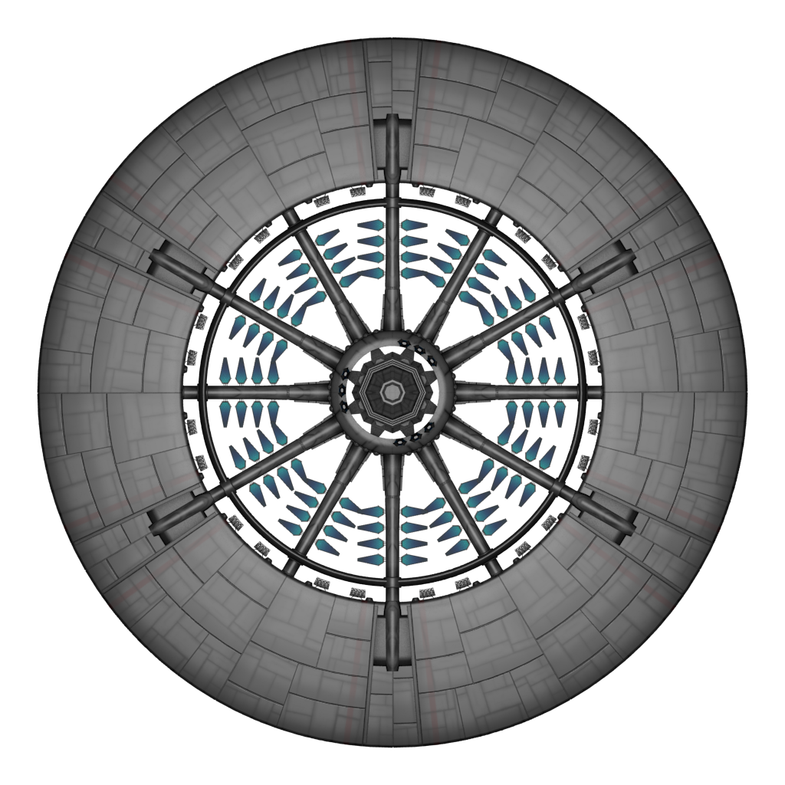

# Father, Where Are You?

Play as a member of the Xerathans, avenge your father against the human race, and find your father.

Entry to the GDDC 2024 Space Exploration Jam. You can play our game here: https://winnie-udel.itch.io/father-where-are-you

## Instructions

| Game Element                                               | Description                                                                                                                         |
| :--------------------------------------------------------- | :---------------------------------------------------------------------------------------------------------------------------------- |
|   | You are a member of the Xerathans.   Use the arrow keys or W and S to move the player up and down. Use the space key to attack! |
|  | Satellite deployed by the minions of Earth!   Once detected by it, it shoots lasers at a rapid pace!                            |
|        | That speed is no joke.   Double the laser and double the speed of the satellite!                                                |
|        | Slow, but dangerous!   Shoots bomb that rapidly decreases your health! Destroy the bomb with your lasers!                       |
|                      | Final boss!   Use both laser and bomb attacks, beware!                                                                          |

## Author

| Name          | UD Email         |
| :------------ | :--------------- |
| Winnie Li     | winnie@udel.edu  |
| Joshua Chelen | jchelen@udel.edu |

## Credits

- Cutscenes animated by Joshua Chelen
- "Player Fighter Jet" by Joshua Chelen
- "Satellite Base" by Joshua Chelen
- "Satellite Dish" by Joshua Chelen
- "Drone Gunner" by Joshua Chelen
- "Drone Bomber" by Joshua Chelen
- ["Textured Space Station" by MillionthVector](https://opengameart.org/content/textured-space-station)
- ["Space Shooter Art" by Kenney](https://opengameart.org/content/space-shooter-art)
- ["Sci-Fi UI Panel" by bart](https://opengameart.org/content/sci-fi-ui-panel)
- ["Camera Mapped Space Background" by Explosive Ninja](https://opengameart.org/content/camera-mapped-space-background)
- ["Space Background 01" by Satur9](https://opengameart.org/content/space-background-01)
- ["Battle in the Winter" by jobromedia](https://opengameart.org/content/battle-in-the-winter)
- ["Through Space" by maxstack](https://opengameart.org/content/through-space)
- ["The Sad Battle" by Eldritch Grim](https://opengameart.org/content/the-sad-battle)
- ["Menu Music" by mrpoly](https://opengameart.org/content/menu-music)
- ["Heroic Deminse [Updated Version]" by Matthew Pablo](https://opengameart.org/content/heroic-demise-updated-version)
- ["The Fallen (RPG Orchestral Essentials) - Defeated Music" by Inspector J](https://opengameart.org/content/the-fallen-rpg-orchestral-essentials-defeated-music)
- ["Menu Selection Click" by NenadSimic](https://opengameart.org/content/menu-selection-click)
- ["Laser Shot" by Mobeyee Sounds](https://opengameart.org/content/laser-shot-0)
- ["Mechanical Explosion" by Spring Spring](https://opengameart.org/content/mechanical-explosion)

## Game Plan

- [x] Wanderer Exist: _A wanderer is on the screen._
- [x] Wanderer Moves: _The wanderer can move up and down with arrow keys._
- [x] Wanderer Attack: _The wanderer can shoot a laser with the space key._
- [x] Screen Limits: _The wanderer cannot be moved offscreen._
- [x] Spawning Enemy Satellite: _Satellite spawns randomly within given boundaries._
- [x] Satellite Moves: _Satellite move from right to left._
- [x] Enemy Drones: _Enemies that shoots laser and bomb._
- [x] Boss Enemy: _Spawns after a set amount of time. Shoots both lasers and bomb._
- [x] Wanderer Hurt: _If an enemy collides with a wanderer, it loses health._
- [x] Display Stats: _The screen will display the current score and health._
- [x] Game Over: _Scene that plays after the player dies._
- [x] Story/Ending Screen: _Cutscenes._
- [x] Home Screen: _Main menu screen exists._
- [x] Instruction Screen: _Screen with player instructions._
